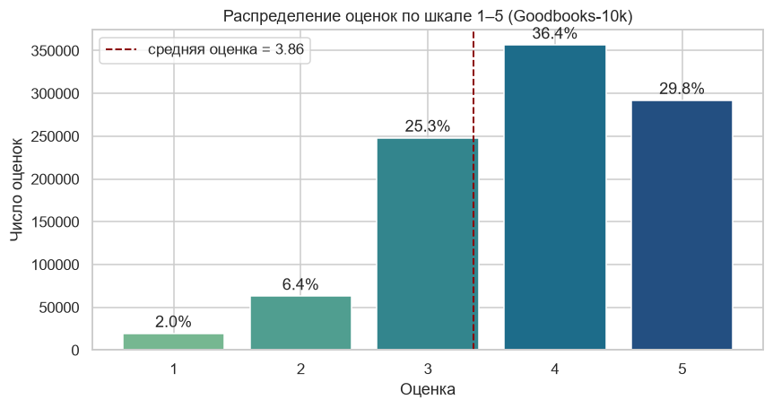
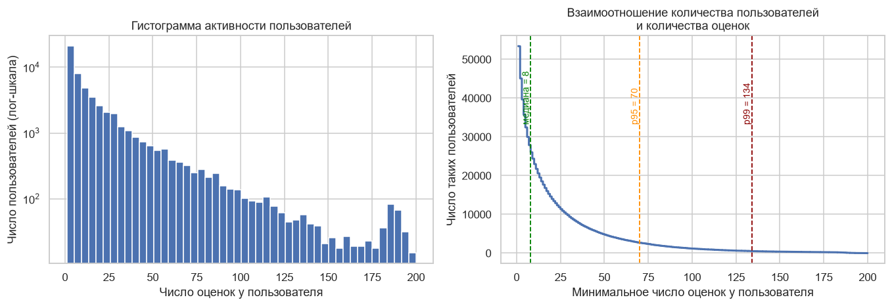
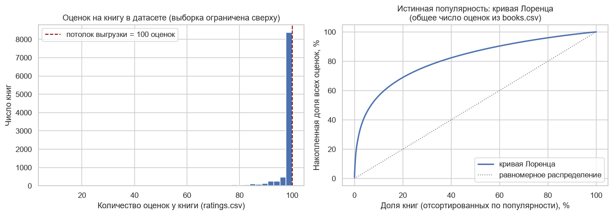
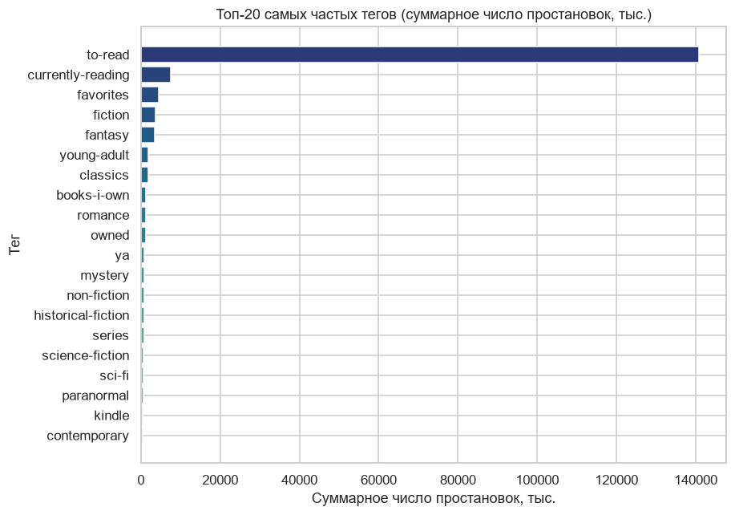
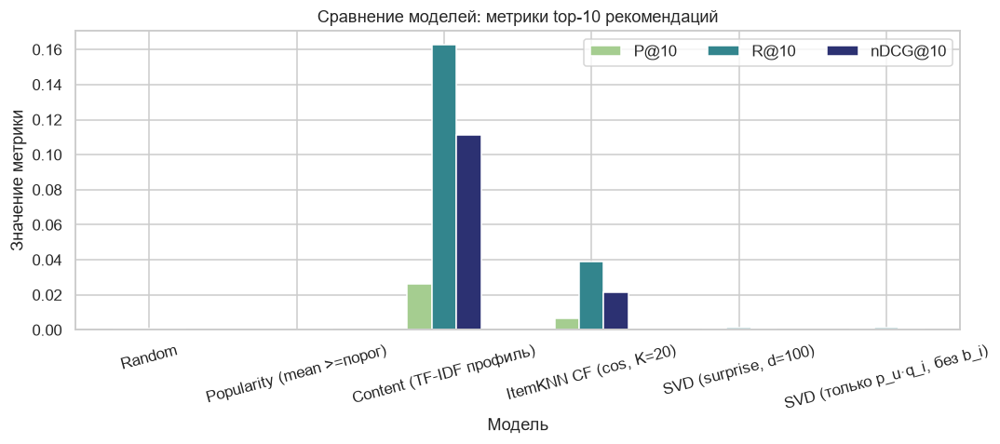
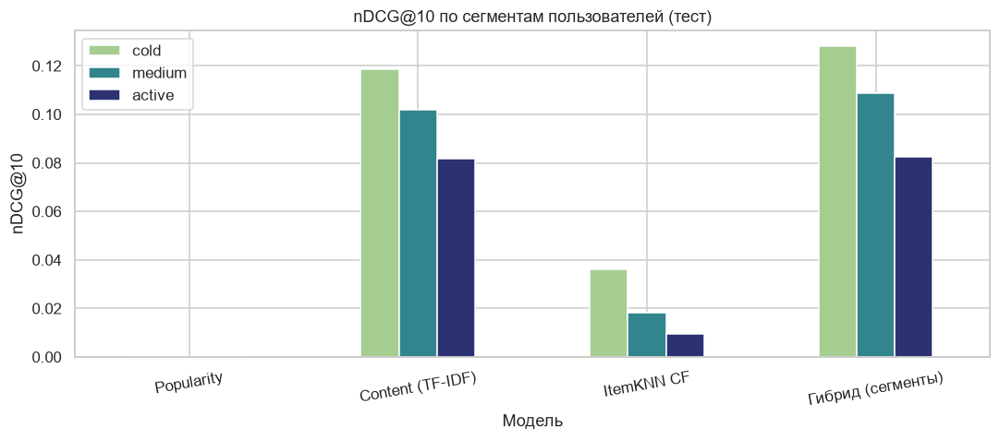
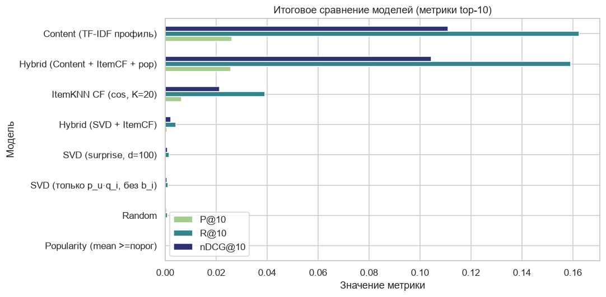

# Рекомендательная система книг (Goodbooks-10k)

Воспроизводимый DVC-пайплайн из девяти стадий: от разведочного анализа до нейросетевого
реранкера на базе Wide & Deep. Все артефакты (графики, таблицы, веса моделей, пулы
кандидатов) создаются командой `dvc repro` в каталоге `artifacts/` и используются в этом
документе.

## Задача

По оценкам пользователей формировать персональный список книг к прочтению и ранжировать
кандидатов. Порог релевантности  - оценка >= 4 (66% всех оценок в датасете). Качество
ранжирования измеряется Precision@K, Recall@K и nDCG@K по скрытым тестовым взаимодействиям,
качество предсказания оценок  - RMSE/MAE.

## Данные

Датасет Goodbooks-10k. Файлы нужно положить в каталог `data/`:

| Файл           | Содержимое                                                       |
|----------------|------------------------------------------------------------------|
| `ratings.csv`  | Оценки пользователей (user_id, book_id, rating)                   |
| `books.csv`    | Метаданные книг: названия, авторы, средние рейтинги, год издания   |
| `tags.csv`     | Словарь тегов                                                     |
| `book_tags.csv`| Привязка тегов к книгам с числом простановок                      |

После добавления данных зафиксируйте их в DVC: `dvc add data`.

## Установка и запуск

```bash
python -m venv .venv
source .venv/bin/activate        # Windows: .venv\Scripts\activate
pip install -r requirements.txt

dvc repro                        # полный прогон всех девяти стадий
dvc metrics show                 # таблицы метрик
dvc plots show                   # графики
dvc params show                  # параметры запуска
dvc dag                          # граф стадий
```

Отдельную стадию можно пересчитать точечно: `dvc repro svd`.

Код отформатирован black, конфигурация лежит в `pyproject.toml`:

```bash
black src
```

## Структура стадий

```text
eda -> split -> base_models -> itemcf -> svd -> evaluate -> hybrid -> reranker -> pipeline_rerun
```

| Стадия            | Скрипт                     | Назначение                                          |
|-------------------|----------------------------|-----------------------------------------------------|
| `eda`             | `src/stage1_eda.py`        | Разведочный анализ, графики распределений            |
| `split`           | `src/stage2_split.py`      | Трёхсторонний сплит: train / val / test              |
| `base_models`     | `src/stage3_base_models.py`| Популярная и контентная (TF-IDF) модели              |
| `itemcf`          | `src/stage4_itemcf.py`     | Item-Based коллаборативная фильтрация                |
| `svd`             | `src/stage5_svd.py`        | Матричное разложение, таблица RMSE                   |
| `evaluate`        | `src/stage6_evaluate.py`   | Метрики ранжирования базовых моделей на тесте        |
| `hybrid`          | `src/stage7_hybrid.py`     | Пул кандидатов, подбор весов, сегменты, диверсификация|
| `reranker`        | `src/stage8_reranker.py`   | Нейросетевой реранкер Wide & Deep                    |
| `pipeline_rerun`  | `src/stage9_pipeline.py`   | Сквозной перезапуск на подвыборке пользователей      |

## Этап 1. Разведочный анализ

После удаления дубликатов пар пользователь-книга: 979 478 оценок, 53 424 пользователя,
10 000 книг, 34 252 тега и 999 912 записей book_tags.

### 1.1. Распределение оценок



Оценки смещены к высоким значениям: средняя 3.856, медиана 4.0, на 4 и 5 приходится 66.2%,
на 1 и 2  - только 8.4%. Люди оценивают книги, которые сами выбрали и дочитали. Из этого
следует, что порог релевантности >= 4 обоснован, а сравнивать модели только по RMSE
некорректно  - наивный прогноз «всем 3.9» уже даёт приемлемую ошибку. Ранжирующие метрики
необходимы.

### 1.2. Активность пользователей



Медианный пользователь поставил 8 оценок, топ-1% активных  - от 134. Почти 40% пользователей
имеют меньше 6 оценок, поэтому холодный старт здесь не гипотетическая проблема, а обычное
состояние данных. Выгрузка ограничена: не больше 200 оценок на человека и 100 на книгу.

### 1.3. Популярность книг



В `ratings.csv` распределение почти равномерное: 6248 книг из 10 000 набрали ровно по 100
оценок, потому что выгрузка обрезана сверху. Настоящая популярность видна в
`work_ratings_count`: топ-1% книг собирает 22.8% всех оценок, топ-10%  - 56.4%.
Смещение популярности никуда не делось  - оно спрятано в метаданных.

### 1.4. Теги и разреженность



Самые частые теги  - служебные (`to-read`, `favorites`, `owned`), дальше идут жанровые.
31 520 уникальных тегов на 10 000 книг  - теги шумные. Плотность матрицы взаимодействий
0.183%, полная dense-матрица заняла бы 2.0 ГБ.

Ключевые проблемы данных:
1. Разреженность  - у большинства пар книг нет ни одного общего оценщика.
2. Смещение популярности  - без персонализации 90% каталога остаются без трафика.
3. Смещение к высоким оценкам  - негативного сигнала почти нет.
4. Холодный старт  - 39% пользователей имеют меньше 6 оценок.
5. Нет временных меток  - кросс-валидация по времени невозможна.

## Этап 2. Трёхсторонний сплит

Для настройки весов гибрида нужна валидационная выборка. У каждого пользователя с >= 6
оценками прячутся 3 случайные оценки: одна  - в валидацию, две  - в тест. Пользователи с
меньшим числом оценок целиком остаются в train и в метриках не участвуют.

| Показатель                          | Значение          |
|-------------------------------------|-------------------|
| train                               | 882 161 оценок    |
| val                                 | 32 439 оценок     |
| test                                | 64 878 оценок     |
| Пользователей в val/test            | 32 439 из 53 424  |
| Пользователей с < 5 train-оценками  | 22 351 (42%)      |

Полная сводка  - [artifacts/tables/split_summary.json](artifacts/tables/split_summary.json).

## Этап 3. Базовые модели

### Популярная модель

Скор книги равен среднему рейтингу в train при числе оценок >= 100. Порог проходит 101
книга из 10 000. Топ выдачи  -
[artifacts/tables/popular_top10_train.csv](artifacts/tables/popular_top10_train.csv).
Персонализации нет, но модель закрывает холодный старт.

### Контентная модель (TF-IDF)

Для каждой книги собирается текстовый профиль из слов названия и тегов (служебные полки
удаляются), векторизуется TF-IDF с L2-нормировкой. Профиль пользователя  - нормированная
сумма профилей его любимых книг. Примеры похожих книг  -
[artifacts/tables/similar_books_demo.csv](artifacts/tables/similar_books_demo.csv):
модель находит продолжения серий, книги того же автора и жанровых соседей. Минус  -
склонность клонировать знакомое; плюс  - работает для книг без единой оценки.

## Этап 4. Коллаборативная фильтрация

Близости книг считаются через произведение разреженных матриц со сжатием, в каждой строке
остаётся топ-20 соседей. Прогноз для пары  - взвешенное среднее оценок пользователя по
соседям книги. Примеры прогнозов  -
[artifacts/tables/itemcf_demo.csv](artifacts/tables/itemcf_demo.csv).

## Этап 5. Матричное разложение

`surprise.SVD` со 100 факторами за 20 эпох. Таблица качества предсказания оценок  -
[artifacts/tables/rmse_table.csv](artifacts/tables/rmse_table.csv):

| Модель                  | RMSE   | MAE    |
|-------------------------|--------|--------|
| SVD (surprise, d=100)   | 0.8534 | 0.6750 |
| User mean               | 0.8912 | 0.6884 |
| ItemKNN CF (cos, K=20)  | 0.9062 | 0.6471 |
| Item mean               | 0.9402 | 0.7562 |
| Global mean             | 0.9785 | 0.7848 |

SVD лучше всех предсказывает значение оценки, но это не гарантирует хорошего ранжирования.

## Этап 6. Метрики ранжирования базовых моделей

Для каждого пользователя берутся скрытые тестовые книги с оценкой >= 4, модель строит
топ-10 по скорингу без уже прочитанных книг.



Результаты  - [artifacts/tables/metrics_main.csv](artifacts/tables/metrics_main.csv):

| Модель                          | P@10   | R@10   | nDCG@10 |
|---------------------------------|--------|--------|---------|
| Random                          | 0.0002 | 0.0011 | 0.0006  |
| Popularity                      | 0.0000 | 0.0000 | 0.0000  |
| Content (TF-IDF)                | 0.0254 | 0.1579 | 0.1042  |
| ItemKNN CF (cos, K=20)          | 0.0067 | 0.0402 | 0.0226  |
| SVD (surprise, d=100)           | 0.0002 | 0.0015 | 0.0008  |
| SVD (только p·q)                | 0.0001 | 0.0008 | 0.0004  |

TF-IDF профили показывают наилучший результат среди одиночных моделей: скрытые книги
пользователей тематически связаны с их историей, и косинусная близость профилей ловит эту
связь напрямую. ItemCF уступает из-за разреженности сооценок. SVD при ранжировании по
абсолютному прогнозу выдаёт всем один и тот же глобальный топ, поэтому метрики падают до
случайного уровня.

## Этап 7. Гибридная система

### Архитектура

1. **Генерация кандидатов.** Для каждого пользователя берутся топ-100 от каждой из четырёх
   моделей (контент, ItemCF, персональная часть SVD, популярное) и объединяются в пул.
   Прочитанное отсеивается на этом этапе.
2. **Ранжирование пула.** Складываются z-нормированные скоры моделей с весами, подобранными
   перебором на валидационной выборке.

### Подбор весов

Перебор по сетке с шагом 0.25 на валидации дал оптимальный микс:
**0.75 контент + 0.25 ItemCF**, ни SVD, ни популярное в топ не вошли. Полная сетка  -
[artifacts/tables/hybrid_weights.csv](artifacts/tables/hybrid_weights.csv).

### Сегментный анализ

Пользователи разбиты на три сегмента по числу оценок в train (холодный < 10, средний 10–39,
активный >= 40). Перебор весов по сегментам дал одинаковый результат для всех трёх  -
сегментация не улучшает веса на этих данных.



Сегментная таблица  - [artifacts/tables/segment_table.csv](artifacts/tables/segment_table.csv).
Контентной модели легче с холодными пользователями (0.119), чем с активными (0.082): у
холодных вкусы узкие и TF-IDF профиль попадает точно, у активных история разнородная и
угадать конкретную книгу сложнее.

### Итоговое сравнение гибридов



| Модель                          | P@10   | R@10   | nDCG@10 |
|---------------------------------|--------|--------|---------|
| Content (TF-IDF)                | 0.0254 | 0.1579 | 0.1042  |
| Гибрид (общие веса)             | 0.0275 | 0.1699 | 0.1109  |
| Гибрид (веса по сегментам)      | 0.0275 | 0.1699 | 0.1109  |

Гибрид даёт +6.4% по nDCG@10 к лучшей одиночной модели. Сегментные веса совпали с общими,
поэтому усложнение не окупилось.

### Диверсификация

Жадные лимиты на число книг одного автора и одного тематического кластера в выдаче:

| Вариант                     | P@10   | nDCG@10 | Покрытие каталога | Доля топ-автора |
|-----------------------------|--------|---------|-------------------|-----------------|
| Без ограничений             | 0.0275 | 0.1109  | 0.949             | 0.390           |
| Мягкие лимиты (3 авт., 5 кл.)| 0.0231 | 0.1006  | 0.947             | 0.230           |
| Жёсткие лимиты (2 авт., 4 кл.)| 0.0202 | 0.0925  | 0.935             | 0.177           |

Мягкие лимиты снижают однообразие выдачи почти без потерь в точности; жёсткие уже
заметно режут метрики, потому что продолжения серий  - именно то, что пользователь
хочет видеть. Оптимально держать мягкие ограничения как страховку от крайних случаев.

## Этап 8. Нейросетевой реранкер

### Архитектура

Поверх гибридного пула обучается реранкер на базе Wide & Deep:

- **Wide-часть**  - линейный слой поверх явных признаков: z-скоры трёх моделей, «тот же
  автор», доля любимого кластера, популярность книги, статистики пользователя и книги.
- **Deep-часть**  - эмбеддинги пользователя и книги (по 16) + числовые признаки через MLP.

Обучение на парах: позитивы  - книги с оценкой >= 4 из train, негативы  - случайные
непрочитанные книги. Всего ~1.5 млн пар.

### Результаты

| Метрика | Широкий + глубокий | Только широкий |
|---------|-------------------|----------------|
| AUC (val) | 0.583            | 0.619          |
| nDCG@10 (test) | 0.116       | 0.123          |

Вариант без глубокой части оказался лучше и по AUC, и по итоговым метрикам. Эмбеддинги
на 1.5 млн пар за 3 эпохи переобучились (лосс на обучении упал до 0.02), а явные признаки
в широкой части несут основной сигнал и обобщаются лучше.

Итоговая таблица со всеми системами  -
[artifacts/tables/metrics_reranker.csv](artifacts/tables/metrics_reranker.csv):

| Система                       | nDCG@10 |
|-------------------------------|---------|
| Content (TF-IDF)              | 0.1042  |
| Гибрид (общие веса)           | 0.1109  |
| Гибрид + Wide&Deep реранк     | 0.1157  |
| Гибрид + wide-only реранк     | 0.1232  |

Реранкер добавляет ещё +11% к гибридному базовому уровню. Суммарный прирост относительно
лучшей одиночной модели составляет ~18%.

## Этап 9. Сквозной перезапуск на подвыборке

Пайплайн перезапускается на случайных 8 000 пользователей: все стадии от сплита до
реранкера выполняются автоматически. Классическая часть воспроизводит расклад полного
прогона, а нейросетевой этап деградирует из-за недостатка обучающих пар. Это подтверждает,
что реранкер требует достаточного объёма данных, тогда как гибридный слой устойчив к
масштабу.

Результат  - [artifacts/tables/pipeline_result.csv](artifacts/tables/pipeline_result.csv).

## Итоги

| Система                              | nDCG@10 | Прирост к базовой |
|--------------------------------------|---------|-------------------|
| Лучшая одиночная (контентная)        | 0.104   |  -                 |
| Гибрид с весами с валидации          | 0.111   | +6.4%             |
| Гибрид + полный Wide & Deep          | 0.116   | +11.1%            |
| Гибрид + wide-only реранкер          | 0.123   | +18.2%            |

1. Двухэтапная схема (пул кандидатов + весовое ранжирование) стабильно превосходит любую
   одиночную модель, при этом валидационный перебор весов не переобучается на тест.
2. Контентный сигнал остаётся доминирующим: и в одиночном зачёте, и в миксе ему отходит
   75% веса. Коллаборативная компонента дополняет его, но не заменяет.
3. Сегментация по активности не дала выигрыша в весах  - оптимальный микс одинаков для
   холодных и активных пользователей, зато сам анализ выявил, что контентной модели легче
   на узких вкусах.
4. Из двух вариантов реранкера линейный (без эмбеддингов) обобщается лучше: глубокую часть
   имеет смысл дообучать при большем объёме данных, с регуляризацией и ранней остановкой.
5. Диверсификацию стоит применять в мягком режиме: она снижает долю одного автора в выдаче
   с 39% до 23% при потере менее 10% точности.

## Направления развития

- Перейти на обучение по неявному фидбеку (BPR, ALS из библиотеки `implicit`) вместо
  регрессии оценок.
- Заменить TF-IDF на текстовые эмбеддинги (Word2Vec по тегам, BERT по описаниям) для
  более устойчивой семантики.
- Добавить признаки контекста (время, устройство, сезонность) и обучить бустинг-ранкер
  поверх скоров моделей.
- Для реранкера: больше негативных примеров, дропаут, ранняя остановка по валидационному
  AUC, увеличение объёма обучающих пар.
- Внедрить A/B-тестирование эффекта диверсификации на живых пользователях.

## Порядок запуска

1. Положить файлы датасета в `data/`.
2. `pip install -r requirements.txt`.
3. `dvc repro`  - пайплайн последовательно выполнит стадии, создаст `dvc.lock` и заполнит `artifacts/`.
4. Проверить метрики: `dvc metrics show`, графики: `dvc plots show`.
5. Перед коммитом прогнать форматирование: `black src`.